# KHÓA LUẬN TỐT NGHIỆP ĐẠI HỌC

## Thiết Kế Kiến Trúc Tổng Thể Hạ Tầng Mạng Không Dây Tại Trường Đại Học Đồng Tháp

  Mã đề tài: 2026.CN.01
  Trường: ĐH Đồng Tháp (DTHU)
  Khoa Công nghệ & Kỹ thuật
  Chuyên ngành: Mạng máy tính & An ninh
  Niên khóa: 2023 – 2027

---

## 🎯 Mục đích Hệ thống Tài liệu Trực tuyến

Hệ thống tài liệu Web Docsify này là cổng thông tin tổng hợp (Dashboard) phục vụ Giảng viên hướng dẫn và Hội đồng đánh giá theo dõi toàn diện tiến độ nghiên cứu, hồ sơ học vụ, toàn văn bản thảo báo cáo, dữ liệu đo kiểm thực địa và tải trực tiếp các ấn phẩm PDF chính thức của khóa luận.

---

## 📋 Thông Tin Học Vụ Chính Thức

| Thông tin | Chi tiết chính thức |
|:---|:---|
| **Cơ sở đào tạo** | Trường Đại học Đồng Tháp (DTHU) |
| **Khoa / Viện** | Khoa Công nghệ và Kỹ thuật |
| **Ngành đào tạo** | Khoa học máy tính |
| **Chuyên ngành** | Mạng Máy Tính và An Ninh |
| **Khóa học / Niên khóa** | Khóa 2023 – 2027 (Bảo vệ tháng 04/2027) |
| **Sinh viên thực hiện** | **Nguyễn Thị Kỳ Duyên** |
| **Mã số sinh viên (MSSV)** | `0023410647` |
| **Lớp sinh hoạt** | ĐHCNTT23B-CS |
| **Giảng viên hướng dẫn** | **TS. Lương Thái Ngọc** |

---

## 🧭 Định Hướng Trọng Tâm Cốt Lõi (Scope Boundary - Chống Lệch Đề)

> [!IMPORTANT]
> **Cam kết liêm chính học thuật và tập trung phạm vi:** Đề tài tập trung 100% công sức giải quyết bài toán nghẽn tải, can nhiễu và thiết kế hạ tầng Enterprise WLAN thực tế tại khuôn viên DTHU. Tuyệt đối không phát triển dàn trải ngoài phạm vi nghiên cứu đã được phê duyệt.

* **Trọng tâm 1 (Kỹ thuật then chốt - 100% công sức):**
  * Khảo sát thực địa bằng Wi-Fi Analyzer và Speedtest tại 14 khối công trình DTHU (Giảng đường A1, C2, B1–B6, H1–H3, Thư viện Lê Vũ Hùng).
  * Chẩn đoán nguyên nhân cốt lõi gây nghẽn tải: Thiết bị điều khiển cũ Motorola RFS6000 nghẽn CPU, can nhiễu kênh truyền 2.4 GHz nghiêm trọng.
  * Thiết kế kiến trúc phân cấp 3 lớp Enterprise Campus WLAN: Core Layer (Switch L3 + Cụm WLC HA Active-Standby N+1), Distribution Layer, Access Layer (PoE+ 802.3at).
  * Chuẩn hóa công nghệ **Wi-Fi 6 (IEEE 802.11ax)**: Đa truy nhập OFDMA, MU-MIMO hai chiều, tô màu nhận diện BSS Coloring.
  * Tối ưu hóa vận hành: Chuyển vùng nhanh **Fast Roaming (IEEE 802.11r/k/v)**, phân hoạch VLAN quy mô `/20`, tối ưu thời gian cấp phát DHCP lease time (2 giờ), xác thực định danh tập trung 802.1X/EAP với FreeRADIUS/LDAP.

* **Trọng tâm 2 (Mô phỏng & Đánh giá định lượng):**
  * Hiện thực hóa mô hình mô phỏng hoàn chỉnh trên **Cisco Packet Tracer 8.x**.
  * Kiểm thử định tuyến đa WAN (3 ISP: Viettel, VNPT, FPT), kiểm thử cô lập người dùng Client Isolation trong cùng SSID.
  * Bảng so sánh định lượng các chỉ số kỹ thuật trước và sau khi áp dụng giải pháp thiết kế mới.

---

## 🗺️ Sơ Đồ Kiến Trúc Phân Cấp 3 Lớp (Enterprise Campus WLAN)

```mermaid
graph TD
    %% ==========================================
    %% TẦNG KẾT NỐI INTERNET (ĐA WAN)
    %% ==========================================
    subgraph WAN_LAYER ["TẦNG KẾT NỐI INTERNET (ĐA WAN)"]
        ISP1["ISP 1: Viettel (Leased Line / FTTH)"]
        ISP2["ISP 2: VNPT (FTTH Tốc độ cao)"]
        ISP3["ISP 3: FPT Telecom (FTTH Dự phòng)"]
    end

    %% ==========================================
    %% LỚP LÕI & TRUNG TÂM DỮ LIỆU (CORE & DATA CENTER)
    %% ==========================================
    subgraph CORE_LAYER ["LỚP LÕI (CORE LAYER) - DATA CENTER"]
        EdgeFW["Cụm Firewall & Edge Router HA (Active/Standby)"]
        CoreSwitch1["Switch Core Lớp 3 - Node 1 (Active)"]
        CoreSwitch2["Switch Core Lớp 3 - Node 2 (Standby)"]
        
        WLC_Primary["WLC Primary (Chính - 500 APs)"]
        WLC_Backup["WLC Standby (Dự phòng N+1)"]
        
        RadiusServer["Cụm FreeRADIUS Server (802.1X/EAP)"]
        DhcpServer["Cụm DHCP / DNS Server (Failover)"]
    end

    %% ==========================================
    %% LỚP PHÂN PHỐI (DISTRIBUTION LAYER)
    %% ==========================================
    subgraph DIST_LAYER ["LỚP PHÂN PHỐI (DISTRIBUTION LAYER)"]
        Dist_A["Dist Switch Khối Giảng đường A"]
        Dist_B["Dist Switch Khối Hành chính B"]
        Dist_H["Dist Switch Khối Tòa nhà H (H3)"]
        Dist_C["Dist Switch Khối C & Thư viện"]
    end

    %% ==========================================
    %% LỚP TRUY CẬP (ACCESS & WI-FI 6 WLAN)
    %% ==========================================
    subgraph ACCESS_WLAN ["LỚP TRUY CẬP (ACCESS & WI-FI 6 WLAN)"]
        PoE_A1["Switch PoE+ 802.3at (Tòa A1)"]
        PoE_B5["Switch PoE+ 802.3at (Căn tin B5)"]
        PoE_Lib["Switch PoE+ 802.3at (Thư viện)"]
        PoE_H3["Switch PoE+ 802.3at (Tòa H3)"]

        AP_A1["AP Wi-Fi 6 A1 (OFDMA, MU-MIMO)"]
        AP_B5["AP Wi-Fi 6 B5 (BSS Coloring)"]
        AP_Lib["AP Wi-Fi 6 Thư viện (Mật độ cao)"]
        AP_H3["AP Wi-Fi 6 H3 (Mật độ cao)"]
    end

    %% ==========================================
    %% ĐƯỜNG KẾT NỐI VẬT LÝ & DỰ PHÒNG (UNDERLAY)
    %% ==========================================
    ISP1 --> EdgeFW
    ISP2 --> EdgeFW
    ISP3 --> EdgeFW

    EdgeFW --- CoreSwitch1
    EdgeFW --- CoreSwitch2

    %% Core Interconnect
    CoreSwitch1 <-->|"Core Interconnect Link (10/40 Gbps)"| CoreSwitch2

    %% WLC Uplinks & Redundancy Link
    CoreSwitch1 --- WLC_Primary
    CoreSwitch2 --- WLC_Backup
    WLC_Primary -.-|"HA Keepalive & Sync (Heartbeat)"| WLC_Backup

    %% Dual-Homing Servers
    RadiusServer --- CoreSwitch1
    RadiusServer --- CoreSwitch2
    DhcpServer --- CoreSwitch1
    DhcpServer --- CoreSwitch2

    %% Dual Uplinks: Distribution to Both Core Switches (Chống SPOF)
    Dist_A --- CoreSwitch1
    Dist_A --- CoreSwitch2
    Dist_B --- CoreSwitch1
    Dist_B --- CoreSwitch2
    Dist_H --- CoreSwitch1
    Dist_H --- CoreSwitch2
    Dist_C --- CoreSwitch1
    Dist_C --- CoreSwitch2

    %% Distribution to Access
    Dist_A --- PoE_A1
    Dist_B --- PoE_B5
    Dist_H --- PoE_H3
    Dist_C --- PoE_Lib

    %% Access PoE to APs
    PoE_A1 --- AP_A1
    PoE_B5 --- AP_B5
    PoE_H3 --- AP_H3
    PoE_Lib --- AP_Lib

    %% ==========================================
    %% ĐƯỜNG HẦM CAPWAP LOGIC (OVERLAY TUNNEL)
    %% ==========================================
    AP_A1 -.->|"CAPWAP Control & Data Tunnel"| WLC_Primary
    AP_Lib -.->|"CAPWAP Control & Data Tunnel"| WLC_Primary
```

---

## ⚡ Bản Đồ Điều Hướng Nhanh Toàn Bộ Nội Dung Repository

### 1. Ấn phẩm Chính thức & Bản in LaTeX
* 📑 **Báo cáo Khóa luận Toàn văn (PDF 56 trang):** [Tải và Đọc Trực Tuyến](publications.md#1-báo-cáo-khóa-luận-tốt-nghiệp-toàn-văn)
* 📊 **Slide Thuyết trình Bảo vệ (Beamer 23 slide):** [Xem Slide Bảo Vệ](publications.md#2-slide-thuyết-trình-bảo-vệ-beamer-presentation)
* ⚙️ **Quy trình Biên dịch Mã nguồn LaTeX:** [Hướng dẫn Biên dịch](publications.md#3-cách-biên-dịch-lại-từ-mã-nguồn-latex)

### 2. Nghiên cứu Chuyên sâu & Tiến độ Thực hiện
* 🔬 **Nghiên cứu What / Why / How:** [Đặc tả Toàn diện Kiến trúc WLAN DTHU](research/TONG_HOP_KIEN_TRUC_MANG_DTHU.md)
* 📅 **Nhật ký Tiến độ Tổng hợp:** [Theo dõi Tiến độ Các Tuần](weekly-changelog.md)
* 📝 **Báo cáo Tuần:** [Tuần 1](reports/week-01.md) | [Tuần 2](reports/week-02.md) | [Tuần 3](reports/week-03.md) | [Tuần 4](reports/week-04.md)

### 3. Dữ liệu Thực nghiệm & Mã Nguồn Kỹ Thuật
* 📈 **Số liệu Đo kiểm 14 Khối nhà DTHU:** [Bảng Đo kiểm & Đánh giá Định lượng](thuc-nghiem/README.md)
* 💻 **Kịch bản Cấu hình & Mô phỏng:** [WLC HA, FreeRADIUS & Packet Tracer](code/README.md)
* 🗺️ **Bản đồ Cấu trúc File Toàn Repo:** [Xem Chi tiết Cây Thư Mục](Cau-truc-toan-repo.md)

### 4. Hồ sơ Học vụ & Quy chuẩn Khoa
* 📋 **Đề cương Chi tiết Khóa luận (Mẫu 3 đã duyệt):** [Xem Đề cương Chính thức](thu-tuc-khoa/de-cuong-khoa-luan.md)
* 📝 **Đơn Đăng ký Đề tài (Mẫu 1a):** [Xem Đơn Đăng ký](thu-tuc-khoa/1.Don-dang-ky-de-tai.md)
* 📆 **Kế hoạch Thực hiện Tuần (Mẫu 2):** [Xem Kế hoạch Tiến độ](thu-tuc-khoa/2.Ke-hoach-thuc-hien.md)
* 🎯 **Tiêu chí Đánh giá & Chấm điểm:** [Rubric Chấm Điểm của Hội đồng](huong-dan/rubric-cham-khoa-luan.md)
