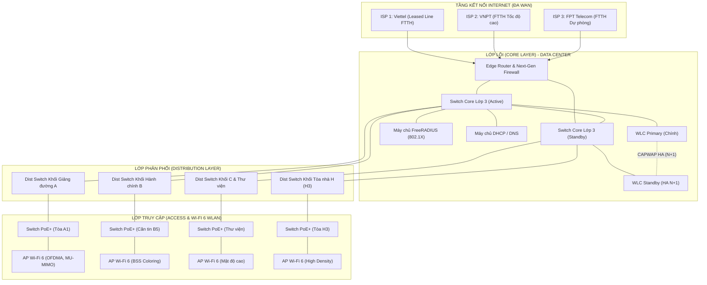

# KHÓA LUẬN TỐT NGHIỆP ĐẠI HỌC

## Thiết Kế Kiến Trúc Tổng Thể Hạ Tầng Mạng Không Dây Tại Trường Đại Học Đồng Tháp

  Mã đề tài: 2026.CN.01
  Trường: ĐH Đồng Tháp (DTHU)
  Khoa Công nghệ & Kỹ thuật
  Chuyên ngành: Mạng máy tính & An ninh
  Niên khóa: 2023 – 2027

---

## 🎯 Mục đích Hệ thống Tài liệu Trực tuyến

Hệ thống tài liệu Web Docsify này là cổng thông tin trực tuyến (Dashboard) phục vụ Giảng viên hướng dẫn và Hội đồng đánh giá theo dõi toàn diện tiến độ nghiên cứu, hồ sơ học vụ, các báo cáo nghiên cứu chuyên sâu hàng tuần và tải trực tiếp các ấn phẩm PDF chính thức của khóa luận.

---

## 📋 Thông Tin Học Vụ Chính Thức

| Thông tin | Chi tiết chính thức |
|:---|:---|
| **Cơ sở đào tạo** | Trường Đại học Đồng Tháp (DTHU) |
| **Khoa / Viện** | Khoa Công nghệ và Kỹ thuật |
| **Ngành đào tạo** | Khoa học máy tính |
| **Chuyên ngành** | Mạng Máy Tính và An Ninh |
| **Khóa học / Niên khóa** | Khóa 2023 – 2027 (Bảo vệ tháng 04/2027) |
| **Sinh viên thực hiện** | **Nguyễn Thị Kỳ Duyên** |
| **Mã số sinh viên (MSSV)** | `0023410647` |
| **Lớp sinh hoạt** | ĐHCNTT23B-CS |
| **Giảng viên hướng dẫn** | **TS. Lương Thái Ngọc** |

---

## 🧭 Định Hướng Trọng Tâm Cốt Lõi (Scope Boundary - Chống Lệch Đề)

> [!IMPORTANT]
> **Cam kết liêm chính học thuật và tập trung phạm vi:** Đề tài tập trung 100% công sức giải quyết bài toán nghẽn tải, can nhiễu và thiết kế hạ tầng Enterprise WLAN thực tế tại khuôn viên DTHU. Tuyệt đối không phát triển dàn trải ngoài phạm vi nghiên cứu đã được phê duyệt.

* **Trọng tâm 1 (Kỹ thuật then chốt - 100% công sức):**
  * Khảo sát thực địa bằng Wi-Fi Analyzer và Speedtest tại 14 khối công trình DTHU (Giảng đường A1, C2, B1–B6, H1–H3, Thư viện).
  * Chẩn đoán nguyên nhân cốt lõi gây nghẽn tải: Thiết bị điều khiển cũ Motorola RFS6000 nghẽn CPU, can nhiễu kênh truyền 2.4 GHz nghiêm trọng.
  * Thiết kế kiến trúc phân cấp 3 lớp Enterprise Campus WLAN: Core Layer (Switch L3 + WLC HA Active-Standby N+1), Distribution Layer, Access Layer (PoE+ 802.3at).
  * Chuẩn hóa công nghệ **Wi-Fi 6 (IEEE 802.11ax)**: Đa truy nhập OFDMA, MU-MIMO hai chiều, tô màu nhận diện BSS Coloring.
  * Tối ưu hóa vận hành: Chuyển vùng nhanh **Fast Roaming (IEEE 802.11r/k/v)**, phân hoạch VLAN quy mô `/20`, tối ưu thời gian cấp phát DHCP lease time (2 – 4 giờ), xác thực định danh tập trung 802.1X/EAP với FreeRADIUS/LDAP.

* **Trọng tâm 2 (Mô phỏng & Đánh giá định lượng):**
  * Hiện thực hóa mô hình mô phỏng hoàn chỉnh trên **Cisco Packet Tracer 8.x**.
  * Kiểm thử định tuyến đa WAN (3 ISP: Viettel, VNPT, FPT), kiểm thử cô lập người dùng Client Isolation trong cùng SSID.
  * Bảng so sánh định lượng các chỉ số kỹ thuật trước và sau khi áp dụng giải pháp thiết kế mới.

---

## 🗺️ Sơ Đồ Kiến Trúc Phân Cấp 3 Lớp

---

## ⚡ Lối Tắt Truy Cập Nhanh

* 📑 **Bản in Khóa Luận PDF (56 trang):** [Tải và Đọc Trực Tuyến](publications.md)
* 📊 **Slide Thuyết Trình Bảo Vệ (23 trang):** [Xem Slide Beamer](publications.md#slide-thuyết-trình-bảo-vệ)
* 📝 **Nghiên cứu Kỹ thuật Chuyên sâu:** [Tổng hợp Kiến trúc Mạng DTHU](research/TONG_HOP_KIEN_TRUC_MANG_DTHU.md)
* 🗓️ **Báo cáo Tiến độ Hàng tuần:** [Nhật ký Tiến độ](weekly-changelog.md)
* 📂 **Bản đồ Cấu trúc Toàn Repo:** [Xem Chi Tiết Cây Thư Mục](Cau-truc-toan-repo.md)
