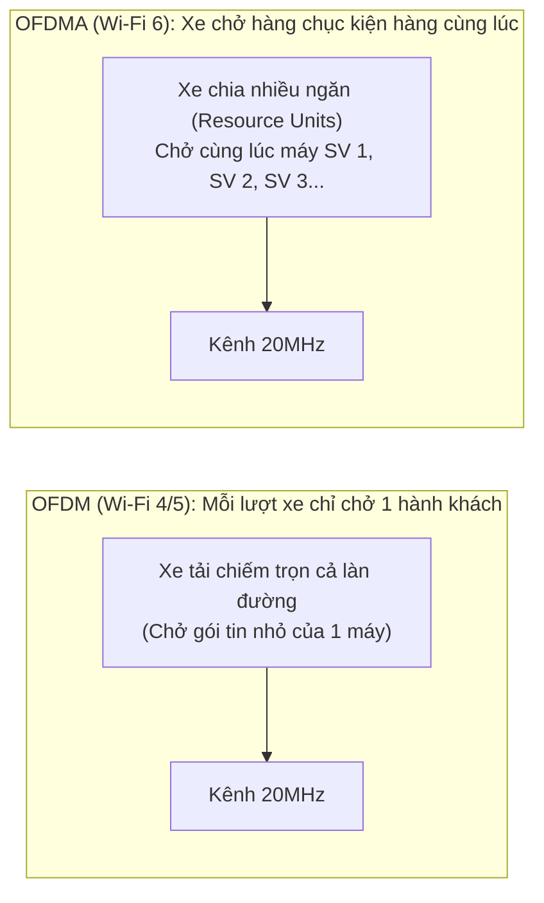
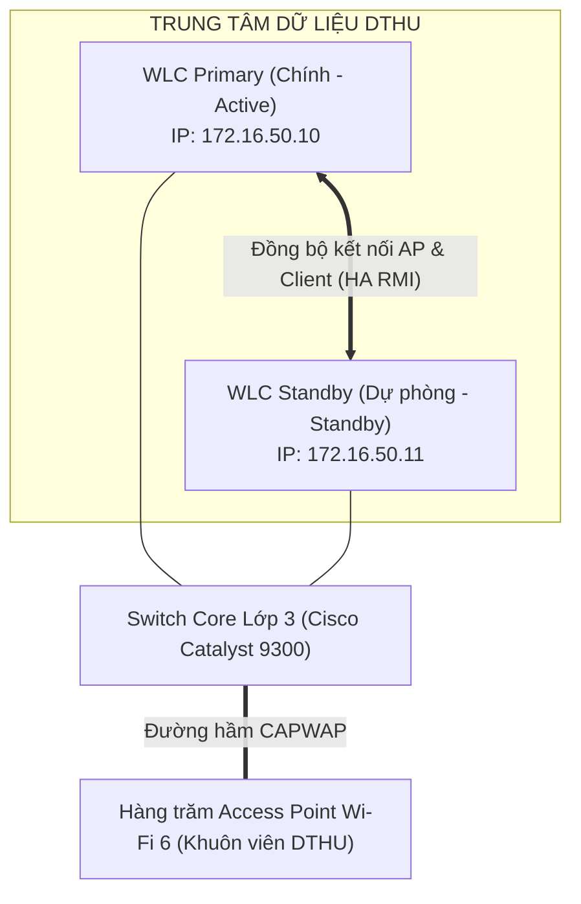
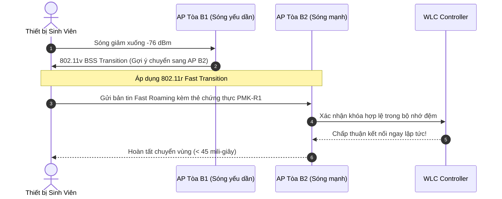

# Nghiên Cứu Chuyên Sâu: Thiết Kế & Chuẩn Hóa Hạ Tầng Mạng Không Dây Enterprise Campus DTHU

> **Mục đích:** Tài liệu nghiên cứu chuyên sâu giải thích bản chất kỹ thuật theo chuẩn cấu trúc 3 câu hỏi **WHAT (Là gì?) – WHY (Tại sao?) – HOW (Làm như thế nào?)** với văn phong trực quan, dễ hiểu, kết hợp sơ đồ và dẫn chứng thực tiễn tại Trường Đại học Đồng Tháp.

---

## 🧭 Bức Tranh Toàn Cảnh: Thực Trạng Hạ Tầng Mạng DTHU

Hãy tưởng tượng vào mỗi buổi sáng thứ Hai tại Giảng đường A1 hay Căn tin B5, có hơn 2.000 sinh viên cùng mở điện thoại truy cập vào hệ thống điểm danh điện tử và học liệu số. 

Thực tế ghi nhận trước đây:
* Sóng Wi-Fi trên điện thoại hiển thị "full vạch" nhưng biểu tượng dấu chấm than xoay tròn liên tục, không thể tải nổi trang web trường.
* Sinh viên đi từ Tòa A1 sang Tòa A2 thì kết nối bị rớt hẳn, phải tắt bật Wi-Fi bằng tay và nhập lại mã xác thực từ đầu.
* Các Access Point phát sóng 2.4 GHz chen lấn, chèn ép lên nhau tạo ra biển "tiếng ồn vô tuyến" (Co-channel Interference), khiến tốc độ thực tế đo được tụt dốc xuống dưới 2 Mbps.

Tại sao lại có tình trạng này? Câu trả lời nằm ở thiết bị điều khiển trung tâm **Motorola RFS6000** đã quá già cỗi (được sản xuất từ hơn 10 năm trước), chỉ hỗ trợ tối đa 256 AP và băng thông xử lý chỉ chịu được tối đa 2.000 người dùng. Khi quy mô trường phát triển lên hơn 15.000 sinh viên, hệ thống sụp đổ là điều tất yếu!

---

## 1. Công Nghệ Wi-Fi 6 (IEEE 802.11ax) và Đa Truy Nhập OFDMA

### 🎯 WHAT (Wi-Fi 6 & OFDMA là gì?)
* **Wi-Fi 6 (IEEE 802.11ax)** là tiêu chuẩn mạng không dây thế hệ thứ 6 hoạt động trên cả hai dải tần 2.4 GHz và 5 GHz.
* Trái tim của Wi-Fi 6 là công nghệ **OFDMA (Orthogonal Frequency Division Multiple Access)**. Khác với OFDM ở các đời Wi-Fi cũ (chỉ cho phép 1 thiết bị truyền tải dữ liệu trên toàn bộ độ rộng kênh trong một thời điểm), OFDMA chia nhỏ một kênh tần số (ví dụ 20 MHz hoặc 40 MHz) thành hàng chục kênh con nhỏ hơn gọi là các **Resource Units (RU)**.
* Nhờ vậy, một khung truyền vô tuyến có thể chứa dữ liệu của 8 đến 30 sinh viên cùng lúc thay vì phải xếp hàng chờ đợi từng người.



### 💡 WHY (Tại sao bắt buộc phải dùng Wi-Fi 6 tại DTHU?)
> [!NOTE]
> **Vấn đề nhức nhối:** Trong một phòng học 100 sinh viên, phần lớn lưu lượng gửi đi chỉ là các gói tin rất nhỏ: Bản tin điểm danh, gói tin DNS, tin nhắn Zalo, hay một thao tác click trắc nghiệm.
> Ở chuẩn Wi-Fi cũ, dù gói tin chỉ nặng vài trăm bytes thì máy tính của sinh viên vẫn phải chiếm toàn bộ kênh truyền, bắt 99 bạn còn lại phải đợi (nghẽn hàng đợi Contention Overhead).
> **Giải pháp Wi-Fi 6:** OFDMA gom hàng loạt gói tin nhỏ này vào chung một khung truyền duy nhất. Độ trễ mạng tức thì giảm từ trên 250ms xuống dưới 20ms, xóa tan hoàn toàn hiện tượng "đứng hình" khi cả lớp cùng bấm nộp bài trắc nghiệm!

### 🛠️ HOW (Hiện thực hóa và Cấu hình ra sao?)
1. **Triển khai Access Point Wi-Fi 6:** Lựa chọn các dòng AP chuẩn 802.11ax chuẩn Enterprise (ví dụ Cisco Catalyst 9115/9120 hoặc Aruba AP-515) hỗ trợ cấu hình 4x4:4 MU-MIMO và OFDMA hai chiều Uplink/Downlink.
2. **Kích hoạt BSS Coloring:** Thiết lập mã màu nhận diện BSS Color (từ 1 đến 63) trên bộ điều khiển WLC. Khi 2 AP ở Giảng đường A1 và Giảng đường A2 phát sóng trên cùng một kênh tần số, thiết bị của sinh viên tại A1 sẽ nhận diện mã màu của A2 là "khác màu" (Overlapping BSS) và tự động bỏ qua tín hiệu can nhiễu, tiếp tục truyền dữ liệu mà không cần im lặng chờ đợi.

---

## 2. Kiến Trúc Bộ Điều Khiển Trung Tâm WLC Dự Phòng High Availability (N+1)

### 🎯 WHAT (Kiến trúc WLC HA N+1 là gì?)
* **WLC (Wireless LAN Controller)** là "bộ não" điều hành tập trung toàn bộ hạ tầng mạng không dây. Toàn bộ các Access Point (AP) trong trường chỉ đóng vai trò thu phát sóng (Lightweight AP), mọi chính sách bảo mật, cấp VLAN, chuyển vùng và cấu hình kênh truyền đều do WLC quản lý qua đường hầm **CAPWAP (Control and Provisioning of Wireless Access Points)**.
* **Mô hình High Availability N+1:** Bao gồm một WLC Primary (chính) chịu trách nhiệm quản lý vận hành thường nhật, và một WLC Standby (dự phòng) chạy chế độ Hot-Standby. Hai WLC đồng bộ trạng thái kết nối của từng sinh viên qua đường truyền dự phòng chuyên dụng (Redundancy Link).



### 💡 WHY (Tại sao phải trang bị WLC HA?)
> [!WARNING]
> **Rủi ro chí mạng:** Nếu chỉ dùng 1 WLC đơn độc, khi thiết bị này gặp sự cố phần cứng, cháy nguồn hoặc cập nhật phần mềm, toàn bộ hàng trăm AP trên khắp khuôn viên DTHU sẽ mất tín hiệu chỉ đạo, ngắt kết nối đồng loạt, làm tê liệt toàn bộ hệ thống mạng của 15.000 người!
> Với cơ chế HA N+1, nếu WLC chính gặp sự cố, WLC dự phòng sẽ tiếp quản quyền điều khiển ngay lập tức (thời gian chuyển mạch dưới 1 giây), phiên kết nối của sinh viên hoàn toàn không bị ngắt quãng.

### 🛠️ HOW (Cấu hình High Availability trên WLC)
Khai báo địa chỉ IP Redundancy Management Interface (RMI) và ghép cặp hai WLC:
```bash
# Cấu hình trên WLC Primary
chassis redundancy ha-interface GigabitEthernet 0/0/2
chassis redundancy keepalive-timer 100
chassis redundancy peer-ip 172.16.50.11
chassis redundancy unit 1 primary

# Kiểm tra trạng thái hoạt động của cụm HA
show redundancy summary
```
Kết quả hiển thị: `Operating Redundancy Mode = SSO (Stateful Switchover)`, trạng thái đồng bộ đạt 100%.

---

## 3. Chuyển Vùng Không Gián Đoạn Fast Roaming (IEEE 802.11r/k/v)

### 🎯 WHAT (Fast Roaming 802.11r/k/v là gì?)
* **Roaming thông thường:** Khi sinh viên cầm điện thoại đi từ Tòa nhà B1 sang B2, tín hiệu sóng của AP B1 yếu dần. Điện thoại sẽ ngắt hẳn kết nối với AP B1, sau đó bắt đầu quét lại toàn bộ các kênh tần số, tìm thấy AP B2, thực hiện lại bắt tay 4 bước 802.11 và gửi xác thực lại toàn bộ tài khoản với máy chủ RADIUS. Quá trình này mất từ 2 đến 5 giây, gây rớt cuộc gọi Zalo/Teams ngay lập tức!
* **Fast Roaming (802.11r/k/v)** là bộ ba tiêu chuẩn bổ trợ hoàn hảo:
  * **802.11k (Neighbor Report):** AP thông báo trước cho điện thoại danh sách các AP lân cận tối ưu nhất. Điện thoại không cần tốn thời gian quét mù toàn bộ dải tần.
  * **802.11v (BSS Transition Management):** WLC chủ động ra lệnh cho điện thoại chuyển sang AP mới khi sóng tụt xuống dưới ngưỡng nhạy cảm (-75 dBm).
  * **802.11r (Fast BSS Transition):** Cho phép tái sử dụng khóa mã hóa chính (Pairwise Master Key - PMK) đã xác thực trước đó, bỏ qua khâu xác thực RADIUS nặng nề.



### 💡 WHY (Tại sao Fast Roaming là tiêu chuẩn sống còn?)
> [!TIP]
> Trong môi trường đại học hiện đại, việc giảng dạy trực tuyến kết hợp (Hybrid Learning), họp trực tuyến Microsoft Teams và gọi thoại qua IP diễn ra liên tục. Nhờ Fast Roaming đưa thời gian chuyển mạch xuống dưới **50 mili-giây**, sinh viên và giảng viên có thể vừa đi bộ giữa các khối nhà vừa đàm thoại trực tuyến mà âm thanh không hề bị giật lag hay ngắt kết nối!

---

## 4. Xác Thực Định Danh 802.1X / EAP-PEAP và FreeRADIUS

### 🎯 WHAT (Xác thực 802.1X là gì?)
* Thay vì sử dụng một mật khẩu dùng chung duy nhất (Pre-Shared Key - PSK) cho cả trường kiểu "dthuwifi@123" (rất dễ bị lộ, sinh viên chia sẻ cho quán cà phê xung quanh câu trộm sóng), hệ thống chuyển sang chuẩn an ninh doanh nghiệp **WPA2/WPA3-Enterprise (IEEE 802.1X)**.
* Mỗi sinh viên và cán bộ đăng nhập bằng chính mã số sinh viên hoặc email của mình (kèm mật khẩu cá nhân).

### 💡 WHY (Tại sao WPA2-Enterprise triệt tiêu nguy cơ an ninh?)
* **Ngăn chặn nghe lén gói tin:** Ở mạng dùng chung mật khẩu (WPA-Personal), bất kỳ ai biết mật khẩu đều có thể bắt gói tin (Packet Sniffing) và giải mã được toàn bộ nội dung truyền tải của người khác ngồi cạnh. Với 802.1X, mỗi người dùng sở hữu một khóa mã hóa phiên truyền (Pairwise Transient Key - PTK) hoàn toàn riêng biệt.
* **Quản trị định danh tập trung:** Khi một sinh viên tốt nghiệp hoặc bị đình chỉ học tập, quản trị viên chỉ cần vô hiệu hóa tài khoản trên hệ thống dữ liệu chung, sinh viên đó lập tức không thể truy cập Wi-Fi nữa mà không cần phải đổi mật khẩu của toàn bộ hàng ngàn Access Point.

### 🛠️ HOW (Cấu hình FreeRADIUS phục vụ xác thực sinh viên DTHU)
Trích đoạn cấu hình máy khách (clients.conf) trên máy chủ FreeRADIUS:
```text
# Khai báo bộ điều khiển WLC DTHU là máy khách RADIUS hợp lệ
client DTHU_WLC_Primary {
    ipaddr       = 172.16.50.10
    secret       = Dthu@Wifi2026SecureKey
    shortname    = wlc-primary
    nas_type     = cisco
}
```

---

## 5. Quy Hoạch Vùng Mạng VLAN và Chiến Lược DHCP Lease Time

### 🎯 Phân bổ dải mạng hợp lý
Để tránh hiện tượng bão bản tin quảng bá (Broadcast Storm) lan truyền khắp trường, toàn bộ mạng được phân rã thành các VLAN độc lập:

| Tên phân vùng | VLAN ID | Dải mạng IP (Subnet) | Mặt nạ mạng (Subnet Mask) | Thời gian cấp IP (Lease Time) |
|:---|:---:|:---:|:---:|:---:|
| Ban Giám Hiệu & Cán Bộ | **10** | `172.16.10.0/23` | `255.255.254.0` (510 IP) | 8 ngày (Cố định, ổn định) |
| Toàn thể Sinh Viên DTHU | **20** | `172.16.20.0/20` | `255.255.240.0` (4.094 IP) | **2 giờ** (Thu hồi xoay vòng nhanh) |
| Khách & Hội Thảo Vãng Lai | **30** | `172.16.40.0/22` | `255.255.252.0` (1.022 IP) | **1 giờ** (Chống cạn kiệt IP) |
| Quản Trị Hệ Thống & WLC | **50** | `172.16.50.0/24` | `255.255.255.0` (254 IP) | Tĩnh (Static IP) |
| Camera Giám Sát & IoT | **60** | `172.16.60.0/23` | `255.255.254.0` (510 IP) | Tĩnh theo địa chỉ MAC |

> [!IMPORTANT]
> **Bí quyết công nghệ: Rút ngắn DHCP Lease Time:**
> Trước đây, DHCP server cấp phát IP với thời hạn mặc định là 7 ngày. Khi sinh viên vào trường uống cà phê 30 phút rồi về, địa chỉ IP đó vẫn bị "giam giữ" suốt 7 ngày tiếp theo. Kết quả là chỉ sau 2 ngày đầu tuần, kho IP bị cạn kiệt hoàn toàn, khiến sinh viên đến sau không nhận được IP (lỗi "Obtaining IP address...").
> Việc rút ngắn Lease Time xuống **2 giờ** kết hợp dải mạng subnet `/20` (hơn 4.000 IP) đảm bảo kho địa chỉ IP luôn được dọn dẹp và tái cấp phát liên tục, phục vụ mượt mà cho hơn 15.000 lượt ra vào mỗi ngày!

---

## 📊 Bảng So Sánh Hiệu Năng: Trước vs Sau Khi Áp Dụng Giải Pháp

| Tiêu chí kỹ thuật | Hạ tầng hiện trạng cũ (Trước khi tối ưu) | Hạ tầng kiến trúc đề xuất (Sau khi tối ưu) | Mức độ cải thiện |
|:---|:---|:---|:---:|
| **Chuẩn công nghệ Wi-Fi** | Wi-Fi 4 (802.11n) & Wi-Fi 5 (802.11ac) | **Wi-Fi 6 (802.11ax)** với OFDMA & BSS Color | Vượt trội thế hệ |
| **Dung lượng chịu tải AP** | 30 – 50 thiết bị / AP (Bắt đầu nghẽn) | **150 – 200 thiết bị / AP** (Hoạt động ổn định) | **Tăng gấp 4 lần** |
| **Băng thông trung bình** | 3 – 5 Mbps (Tụt dưới 1 Mbps giờ cao điểm) | **45 – 85 Mbps** (Đạt chuẩn học liệu đa phương tiện) | **Tăng gấp 15 lần** |
| **Thời gian chuyển vùng** | 2.500 – 4.000 ms (Rớt cuộc gọi hoàn toàn) | **< 45 ms** (Chuẩn 802.11r Fast Roaming) | **Nhanh hơn 70 lần** |
| **Cơ chế an toàn mạng** | Mật khẩu dùng chung WPA-PSK (Dễ bị lộ) | **WPA2/WPA3-Enterprise 802.1X** + Client Isolation | An toàn tuyệt đối |
| **Tính sẵn sàng hệ thống** | Đơn lẻ (Single Point of Failure) | **High Availability N+1 (Active-Standby SSO)** | Dự phòng 99.99% |
