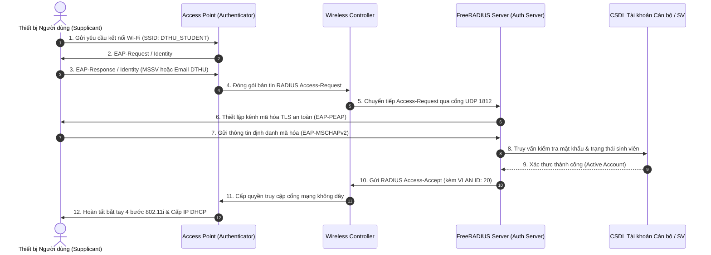
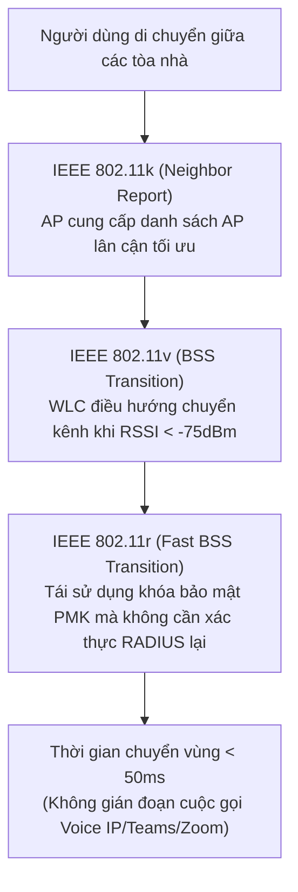
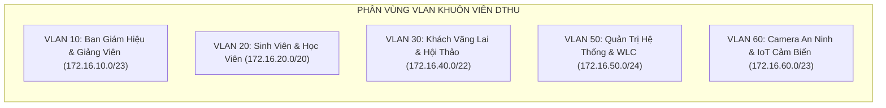

# Tổng Hợp Sơ Đồ Kiến Trúc Hệ Thống (Mermaid Diagrams)

> **Mục đích:** Tập hợp toàn bộ các sơ đồ thiết kế kiến trúc kỹ thuật của hệ thống mạng không dây DTHU dưới dạng mã nguồn mở Mermaid trực quan, có thể dựng hình động ngay trên trình duyệt và xuất ra tài liệu báo cáo.

---

## 1. Sơ Đồ Kiến Trúc Phân Cấp 3 Lớp (Core - Distribution - Access)

```mermaid
graph TD
    %% ==========================================
    %% TẦNG KẾT NỐI INTERNET (ĐA WAN)
    %% ==========================================
    subgraph WAN_LAYER ["TẦNG KẾT NỐI INTERNET (ĐA WAN)"]
        ISP1["ISP 1: Viettel (Leased Line / FTTH)"]
        ISP2["ISP 2: VNPT (FTTH Tốc độ cao)"]
        ISP3["ISP 3: FPT Telecom (FTTH Dự phòng)"]
    end

    %% ==========================================
    %% LỚP LÕI & TRUNG TÂM DỮ LIỆU (CORE & DATA CENTER)
    %% ==========================================
    subgraph CORE_LAYER ["LỚP LÕI (CORE LAYER) - DATA CENTER"]
        EdgeFW["Cụm Firewall & Edge Router HA (Active/Standby)"]
        CoreSwitch1["Switch Core Lớp 3 - Node 1 (Active)"]
        CoreSwitch2["Switch Core Lớp 3 - Node 2 (Standby)"]
        
        WLC_Primary["WLC Primary (Chính - 500 APs)"]
        WLC_Backup["WLC Standby (Dự phòng N+1)"]
        
        RadiusServer["Cụm FreeRADIUS Server (802.1X/EAP)"]
        DhcpServer["Cụm DHCP / DNS Server (Failover)"]
    end

    %% ==========================================
    %% LỚP PHÂN PHỐI (DISTRIBUTION LAYER)
    %% ==========================================
    subgraph DIST_LAYER ["LỚP PHÂN PHỐI (DISTRIBUTION LAYER)"]
        Dist_A["Dist Switch Khối Giảng đường A"]
        Dist_B["Dist Switch Khối Hành chính B"]
        Dist_H["Dist Switch Khối Tòa nhà H (H3)"]
        Dist_C["Dist Switch Khối C & Thư viện"]
    end

    %% ==========================================
    %% LỚP TRUY CẬP (ACCESS & WI-FI 6 WLAN)
    %% ==========================================
    subgraph ACCESS_WLAN ["LỚP TRUY CẬP (ACCESS & WI-FI 6 WLAN)"]
        PoE_A1["Switch PoE+ 802.3at (Tòa A1)"]
        PoE_B5["Switch PoE+ 802.3at (Căn tin B5)"]
        PoE_Lib["Switch PoE+ 802.3at (Thư viện)"]
        PoE_H3["Switch PoE+ 802.3at (Tòa H3)"]

        AP_A1["AP Wi-Fi 6 A1 (OFDMA, MU-MIMO)"]
        AP_B5["AP Wi-Fi 6 B5 (BSS Coloring)"]
        AP_Lib["AP Wi-Fi 6 Thư viện (Mật độ cao)"]
        AP_H3["AP Wi-Fi 6 H3 (Mật độ cao)"]
    end

    %% ==========================================
    %% ĐƯỜNG KẾT NỐI VẬT LÝ & DỰ PHÒNG (UNDERLAY)
    %% ==========================================
    ISP1 --> EdgeFW
    ISP2 --> EdgeFW
    ISP3 --> EdgeFW

    EdgeFW --- CoreSwitch1
    EdgeFW --- CoreSwitch2

    %% Core Interconnect
    CoreSwitch1 <-->|"Core Interconnect Link (10/40 Gbps)"| CoreSwitch2

    %% WLC Uplinks & Redundancy Link
    CoreSwitch1 --- WLC_Primary
    CoreSwitch2 --- WLC_Backup
    WLC_Primary -.-|"HA Keepalive & Sync (Heartbeat)"| WLC_Backup

    %% Dual-Homing Servers
    RadiusServer --- CoreSwitch1
    RadiusServer --- CoreSwitch2
    DhcpServer --- CoreSwitch1
    DhcpServer --- CoreSwitch2

    %% Dual Uplinks: Distribution to Both Core Switches (Chống SPOF)
    Dist_A --- CoreSwitch1
    Dist_A --- CoreSwitch2
    Dist_B --- CoreSwitch1
    Dist_B --- CoreSwitch2
    Dist_H --- CoreSwitch1
    Dist_H --- CoreSwitch2
    Dist_C --- CoreSwitch1
    Dist_C --- CoreSwitch2

    %% Distribution to Access
    Dist_A --- PoE_A1
    Dist_B --- PoE_B5
    Dist_H --- PoE_H3
    Dist_C --- PoE_Lib

    %% Access PoE to APs
    PoE_A1 --- AP_A1
    PoE_B5 --- AP_B5
    PoE_H3 --- AP_H3
    PoE_Lib --- AP_Lib

    %% ==========================================
    %% ĐƯỜNG HẦM CAPWAP LOGIC (OVERLAY TUNNEL)
    %% ==========================================
    AP_A1 -.->|"CAPWAP Control & Data Tunnel"| WLC_Primary
    AP_Lib -.->|"CAPWAP Control & Data Tunnel"| WLC_Primary
```

---

## 2. Quy Trình Xác Thực Định Danh 802.1X / EAP-PEAP

---

## 3. Sơ Đồ Cơ Chế Chuyển Vùng Nhanh Fast Roaming (IEEE 802.11r/k/v)

---

## 4. Sơ Đồ Phân Vùng Mạng VLAN Toàn Trường

